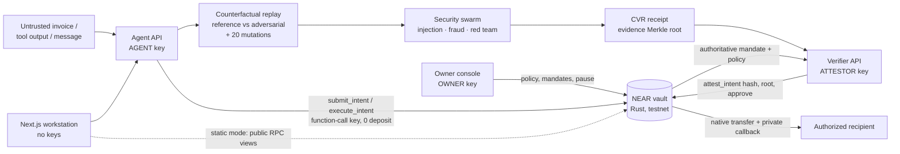

# Architecture

## Security objective

A compromised AI payment agent must not be able to move vault funds outside a business mandate that the owner wrote independently. AI findings are evidence. Authorization comes from deterministic invariants, and the NEAR vault re-checks them immediately before it moves funds.

## Components

| Component | Code | Holds | Responsibility |
| --- | --- | --- | --- |
| Vault contract | `contracts/aegis-vault` | the funds | Owner policy and mandates, canonical intent hash, per-agent nonces, all-violations policy check, attestation binding, budget reservation, transfer and private settlement callback, pause, bounded audit ring |
| Agent API (:8000) | `aegis/agent_api.py` | AGENT key only | Runs the transaction agent on untrusted input; drives the pipeline (propose → replay → swarm → receipt → verifier → chain); attack lab; vault status |
| Verifier API (:8001) | `aegis/verifier_api.py` | ATTESTOR key only, bearer token | Recomputes the intent hash, every policy check and the evidence Merkle root. Takes the mandate from the chain (testnet) or the local vault, **never from the agent**. Attests approve or deny on-chain |
| Owner API (:8002) | `aegis/owner_api.py` | OWNER key only, bearer token | Creates and revokes mandates, changes policy (version + 1), pause and unpause |
| Replay engine | `aegis/replay.py`, `aegis/localvault.py` | — | Holds one mandate snapshot constant; runs the reference and adversarial twins through a faithful vault simulation; generates 20 single-field and injection variations |
| Security swarm | `aegis/swarm.py` | — | Three investigators with schema-validated findings (role, severity, evidence, challenged invariant). Explanations only |
| Receipts | `aegis/receipts.py`, `packages/receipt-verifier` | — | `aegis.cvr/1`: intent, mandate snapshot, policy results, findings, Merkle root over evidence sections, receipt hash. Python and TypeScript verifiers are independent implementations |
| NEAR client | `packages/near-client` | one key per process | near-api-js 7.4.0, RPC failover, role assertion, outcome parsing, evidence ledger |
| Role runner | `scripts/testnet-role.mjs` | — | Starts a process with exactly one role key and strips every other `NEAR_*_PRIVATE_KEY` |
| Workstation | `apps/web` | nothing | Seven views plus a guided demo. Live mode talks to the local services; static mode shows recorded evidence and reads live vault state over public RPC |

## Lifecycle of a payment

1. **Owner** writes the policy (allowlist, per-transaction cap, daily limit, version) and a mandate: id, recipient, exact amount, maximum total, purpose, SHA-256 of the authorized invoice, expiry, policy version.
2. **Agent** reads the untrusted invoice and builds an intent: `network_id, vault_id, agent_id, authorization_id, recipient, asset, amount, action, nonce, expires_at_ms, policy_version, invoice_fingerprint, purpose_id`. It submits the intent (`submit_intent`), which consumes the next per-agent nonce and records the intent as `PROPOSED` (evidence of what the agent tried, good or bad).
3. **Replay** runs the authorized invoice and the received invoice through the same agent and mandate, plus 20 counterfactual variations. **Swarm** explains the difference. The result is sealed into a CVR.
4. **Verifier** recomputes everything, loads the mandate from the vault, and calls `attest_intent(hash, evidence_root, approved)`. Approval re-runs every invariant inside the contract, so a compromised attestor cannot approve a violating intent. Denials are always allowed, even while the vault is paused.
5. **Agent** calls `execute_intent(hash)`. The vault re-checks current state (pause, revocation, expiry, policy version, attestor generation, budgets), **reserves** the amount against the mandate and the daily budget, dispatches the transfer, and settles in the `#[private]` callback `on_execution_complete`. If the transfer fails, the reservation is released and the nonce stays consumed.

## Canonical intent hash

Borsh encoding in field order: six strings (u32 LE length + UTF-8), `amount` as u128 LE, `action` string, `nonce`, `expires_at_ms`, `policy_version` as u64 LE, then `invoice_fingerprint` and `purpose_id` strings. The hash is the SHA-256 of those bytes, as lowercase hex. Rust (`hash_intent`), Python (`aegis/canonical.py`) and TypeScript (`packages/near-client/src/canonical.ts`, `packages/receipt-verifier`) are tested against the shared `packages/shared-types/canonical-vectors.json`.

## Policy parity

`packages/shared-types/policy-vectors.json` holds 31 vectors: an intent, a state, and the exact ordered list of violation codes. The Rust contract test `policy_vectors_match_contract_violations`, the Python test suite and the TypeScript verifier all evaluate every vector and must produce identical codes.

Violation order: `VAULT_PAUSED, WRONG_DOMAIN, AGENT_NOT_REGISTERED, UNSUPPORTED_ACTION, RECIPIENT_NOT_ALLOWED, MAX_TRANSACTION, POLICY_VERSION, INTENT_EXPIRED`, then mandate checks (`AUTHORIZATION_NOT_FOUND` or `AUTHORIZATION_REVOKED, _EXPIRED, _PRINCIPAL, _POLICY_VERSION, _RECIPIENT, _AMOUNT, _ACTION, INVOICE_MISMATCH, PURPOSE_MISMATCH, AUTHORIZATION_BUDGET`), then `DAILY_BUDGET`.

## Evidence and receipts

The CVR evidence root is a Merkle root over six sections: `snapshot, reference, adversarial, variations, findings, provenance`. Each section can be disclosed on its own with a Merkle proof. The root is committed on-chain in `attest_intent`. A receipt carries four separate verdicts:

* **INTEGRITY**: the hashes and the Merkle root recompute.
* **POLICY**: the decision follows from the bound intent and mandate.
* **ON-CHAIN**: with `--network`, the vault recorded the same decision and evidence root for this intent hash.
* **AI ANALYSIS UNVERIFIED**: always shown. Findings are explanations.

## Service hardening

The services enforce an origin allowlist (`AEGIS_WEB_ORIGINS`), require an `X-AEGIS-Client` header on state-changing requests (CSRF), apply per-route rate limits, bound request bodies, and protect owner and verifier routes with bearer tokens. A service refuses to start if it receives another role's private key. SQLite (`runtime/aegis.sqlite3`) is an index, never an authority.

## Modes

| Mode | Start | Keys | Chain |
| --- | --- | --- | --- |
| `LOCAL_SIMULATION` | `pnpm dev` | none | in-process vault simulation with the same invariants |
| `TESTNET` | `pnpm dev:testnet` | one per service | live vault on NEAR testnet |
| Static viewer | `pnpm build:static` | none | recorded evidence + public RPC views |

The UI labels the mode, the agent type (`OFFLINE_HEURISTIC` or an LLM) and the evidence source on every screen.
